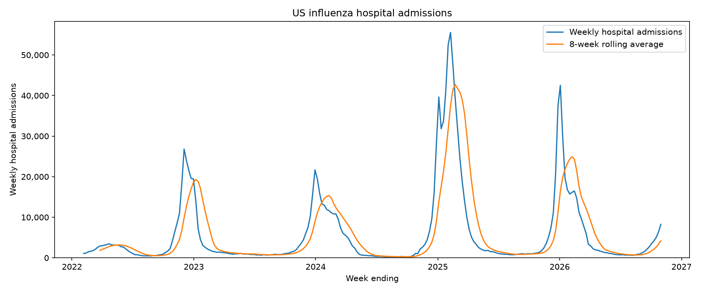
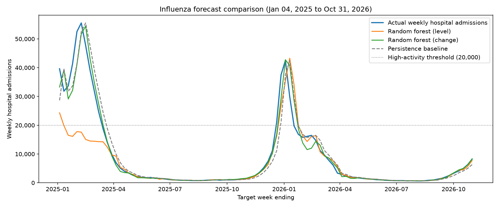
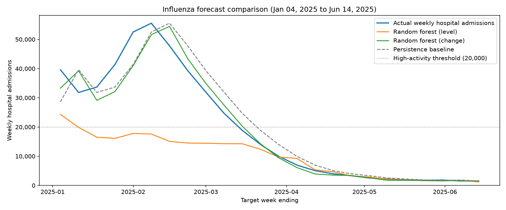
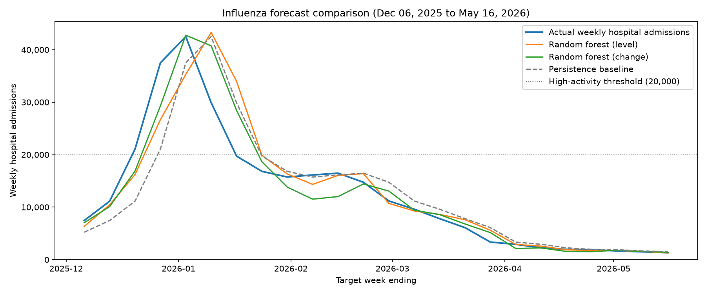

# Forecasting next week's US flu hospital admissions

I am a biology graduate and an EMT, building toward work in epidemiology and public-health analytics. This project asks a practical question: once this week's US flu hospital admissions are known, can a simple model predict next week better than guessing that next week will match this week?

The short answer from this run: a random forest that predicts the week-to-week change, then adds it to this week's total, has the lowest error. A random forest that predicts next week's level directly does worse than guessing "same as this week," because it cannot follow a peak higher than anything in its training data.

## Question

Given national admissions for the current week, what is next week's number of laboratory-confirmed influenza hospital admissions in the United States? I score a one-week horizon only, with point forecasts, against a persistence baseline.

## Data

The series is the hospital-admissions target from the CDC FluSight forecast hub:

[target-hospital-admissions.csv](https://raw.githubusercontent.com/cdcepi/FluSight-forecast-hub/main/target-data/target-hospital-admissions.csv)

FluSight's evaluation data for this target is weekly laboratory-confirmed influenza hospital admissions from the [NHSN Weekly Hospital Respiratory Data](https://data.cdc.gov/Public-Health-Surveillance/Weekly-Hospital-Respiratory-Data-HRD-Metrics-by-Ju/ua7e-t2fy/about_data) set, republished in the [FluSight forecast hub](https://github.com/cdcepi/FluSight-forecast-hub). I keep `location_name == "US"`. Each date is the Saturday that ends the reporting week.

In this run the national series has 248 weeks, from the week ending 2022-02-05 through the week ending 2026-10-31. The highest week is 55,544 admissions on 2025-02-08. The average week is 5,936.8.

October through May is treated as the flu season (the same window as `date >= October 1` and `date < June 1`). Peaks and season totals below are computed from that rule. A season is marked partial when the file is missing either October or May. The 2021-2022 row is only the tail of that season, because the file starts on 2022-02-05. The 2026-2027 row is only the first five October weeks, through 2026-10-31. The 8,245 on 2026-10-31 is the highest of those five weeks.

| Season | Coverage | Weeks | Peak admissions | Peak week | Sum of weekly admissions |
| --- | --- | --- | --- | --- | --- |
| 2021-2022 | partial | 17 | 3,446 | 2022-04-23 | 42,870 |
| 2022-2023 | complete | 35 | 26,795 | 2022-12-03 | 217,904 |
| 2023-2024 | complete | 34 | 21,662 | 2023-12-30 | 243,458 |
| 2024-2025 | complete | 35 | 55,544 | 2025-02-08 | 547,219 |
| 2025-2026 | complete | 35 | 42,500 | 2026-01-03 | 321,714 |
| 2026-2027 | partial | 5 | 8,245 | 2026-10-31 | 27,250 |

2023-2024 has 34 Saturday weeks in October–May. The other complete seasons have 35. The national series itself has a row every 7 days.



## Methods

The model table has 240 rows. The first weeks are dropped until the rolling average and the lags exist, and the last week is dropped because it has no next week to predict.

### Features

Each row is one forecast origin. Everything in the feature list is known on that Saturday:

- this week's admissions (`value`)
- an 8-week rolling average
- lags of 1, 2, 3, 4, and 5 weeks
- the change from last week, and the percent change
- the ISO week of the year

The level target is admissions `HORIZON = 1` week later. The change target is that future value minus this week's value.

### Models

All three forecasts use the same origin and the same one-week target.

1. **Level model.** `RandomForestRegressor` with 100 trees and `random_state=42`. It predicts next week's admissions directly.
2. **Change model.** The same forest predicts the change from this week to next week. I add that change to this week's known admissions.
3. **Persistence baseline.** Next week's prediction is this week's admissions.

A random forest predicts an average of training outcomes. The level model therefore cannot produce a number above the highest target it was trained on. The change model is still limited by the largest change in its training data, but adding that change to the current level can land above the old peak. That difference is the reason to compare the two forests.

### Walk-forward validation

`TimeSeriesSplit` with `n_splits=4` and `test_size=24` walks forward through the 240 rows. Each fold trains on every earlier row and tests on the next 24 weeks. The first training block is 144 weeks, from 2022-03-26 through 2024-12-21. Later folds add those test weeks to the training history. Training ends before the test weeks begin.

The last training row stays in the training set. Its target is admissions on the first test date, which is already the first test row's current value. The label being scored is the week after that.

Forecasts in the figures are drawn on the target week (origin date plus 1 week), which is the Saturday the prediction is for.

### Scores

- **MAE:** mean absolute error, in admissions per week, on all 24 test weeks.
- **High-activity MAE:** the same error on test weeks whose actual admissions are at least 20,000. The cutoff is my definition of a high week. It is applied to the actual target, so all three models are scored on the same weeks. Folds 2 and 4 have no such week.
- **Peak timing and magnitude:** the week of the highest prediction compared with the week of the highest actual value. Timing error is in weeks. Positive means the predicted peak is late. Magnitude error is the absolute difference in height between those two weeks, which may not be the error on the actual peak week.

## Results

MAE for each fold, then the average. Copied from `results/walk_forward_mae.md` for this run:

| Fold | Target weeks | Level MAE | Change MAE | Baseline MAE | High-activity weeks | Level high-activity MAE | Change high-activity MAE | Baseline high-activity MAE |
| --- | --- | --- | --- | --- | --- | --- | --- | --- |
| 1 | 2025-01-04 to 2025-06-14 | 9,955.0 | 2,725.6 | 4,031.0 | 10 | 22,773.7 | 5,955.0 | 7,337.2 |
| 2 | 2025-06-21 to 2025-11-29 | 108.2 | 117.6 | 232.9 | 0 |  |  |  |
| 3 | 2025-12-06 to 2026-05-16 | 2,751.0 | 2,248.7 | 3,330.2 | 4 | 9,074.0 | 5,873.2 | 10,989.0 |
| 4 | 2026-05-23 to 2026-10-31 | 151.9 | 101.1 | 349.7 | 0 |  |  |  |
| Average | 2025-01-04 to 2026-10-31 | 3,241.5 | 1,298.3 | 1,985.9 | 14 | 18,859.5 | 5,931.6 | 8,380.6 |

Overall MAE in the average row is the mean of the four fold MAEs. Each fold has 24 test weeks, so this is also the MAE on every test week together.

High-activity MAE in the average row is the MAE on every test week with at least 20,000 admissions, pooled across folds (14 weeks). Fold 1 contributes 10 of those weeks and fold 3 contributes 4, so the pooled error gives the longer stretch more weight.

The change model has the lowest average MAE, at 1,298.3, compared with 1,985.9 for persistence and 3,241.5 for the level model. It also has the lowest error on the 14 high-activity weeks (5,931.6, versus 8,380.6 for persistence and 18,859.5 for the level model). Fold 2 is the one fold where the level model is slightly better than the change model (108.2 versus 117.6). Both still beat persistence on that fold (232.9).



The orange level model misses the first peak and tracks the second. By the second peak, the record season is already in the training data, so the level model is no longer stuck under an old maximum. The green change model follows both peaks. The gray dashed baseline lags the peaks by one week, which is what copying the latest week forward does.

### Why the level model misses the 2024-2025 peak

Fold 1 tests target weeks 2025-01-04 through 2025-06-14. Training ends 2024-12-21 (144 weeks). The highest next-week value in that training block is 28,639. The highest *current-week* value in training is 26,795. The test peak is 55,544, on 2025-02-08.

The level model's highest prediction on that fold is 24,314.35, on 2025-01-04. That is under the training-target ceiling of 28,639, and far under the test peak. Peak timing error is -5 weeks. Peak magnitude error is 31,229.65.

The change model's highest prediction is 54,444.83, on 2025-02-15. Timing error is +1 week. Magnitude error is 1,099.17.

Persistence also lands on 55,544, on 2025-02-15, so its magnitude error is 0.00 and its timing error is +1 week. That match is the real peak copied into the following week's forecast. It is a one-week delay. The baseline MAE on this fold is still 4,031.0, higher than the change model's 2,725.6.



On the 10 high-activity weeks in fold 1, MAE is 22,773.7 (level), 5,955.0 (change), and 7,337.2 (baseline).

### The next season, after the record week is in training

Fold 3 tests target weeks 2025-12-06 through 2026-05-16. The training target now includes 55,544, and the test peak is 42,500 on 2026-01-03. The level model can reach that height: its highest prediction is 43,302.09, on 2026-01-10 (timing error +1 week, magnitude error 802.09). The change model peaks on the actual peak week, at 42,762.49 (timing error 0, magnitude error 262.49). Persistence again copies the peak one week later: 42,500 on 2026-01-10, magnitude error 0.00, timing error +1 week.

Fold MAE on those 24 weeks is 2,751.0 (level), 2,248.7 (change), and 3,330.2 (baseline). On the 4 high-activity weeks it is 9,074.0, 5,873.2, and 10,989.0.



Folds 2 and 4 are the low seasons (target weeks 2025-06-21 to 2025-11-29, and 2026-05-23 to 2026-10-31). Neither has a week at or above 20,000. Those charts are `figures/fold_2_comparison.png` and `figures/fold_4_comparison.png`.

### What the level model is using

On the last fold, which has the longest training history (216 weeks, through 2026-05-09), importance in the level model is 0.9113 on the current week's admissions and 0.0332 on the weekly change. The forest is mostly anchored to the latest level. That is why "same as this week" is the right baseline, and why asking the forest for the change is a better use of the same features when the level moves into new territory.

Full tables, including every fold's peak errors and the out-of-fold predictions, are in `results/`.

## Limitations

- **One series.** The model is fit only to the national total. The same file has state rows, and states peak on different weeks. A national number is silent about which hospitals are about to fill.
- **Point forecasts only.** Each model returns one number per week. FluSight scores probabilistic forecasts with the weighted interval score (WIS). The MAE here is the error of a point forecast.
- **The level model cannot extrapolate.** It cannot predict a value above the highest target in its training set. On fold 1 that ceiling is 28,639, the test peak is 55,544, and the level model's highest prediction is 24,314.35. Predicting the change is what lets the second forest reach 54,444.83 on that fold. The change model can still only predict changes it has seen in training. Landing within 1,099.17 of this peak is one season. The next record can be a different shape.
- **This week is treated as known.** The features include the current week's national total. The forecast is for the following week, after that total is in the file. In the live challenge the newest NHSN week is often still being reported, and teams also submit a nowcast of the current week.
- **The target file is revised.** NHSN updates recent weeks as reporting finishes, and FluSight appends new weeks. These figures match the file used for this run (through the week ending 2026-10-31). A later run can move the numbers.
- **The average is carried by one hard season.** Fold 1's level MAE is 9,955.0. The two low-season folds have errors in the low hundreds. Two of the four folds never reach the 20,000 cutoff, so the high-activity score is 14 weeks from two seasons.
- **The cutoff is a choice.** 20,000 admissions is the high-activity line I set for this project.

## Next steps

1. Score horizons of 1, 2, 3, and 4 weeks.
2. Submit quantile or prediction-interval forecasts and score them with WIS.
3. Compare those forecasts with the FluSight ensemble on the same weeks and locations.
4. Repeat the walk-forward setup at state level, where the peaks are sharper and less aligned with the national curve.

## How to run

The script needs a network connection. It downloads the FluSight target file, writes PNGs to `figures/`, and writes CSV and markdown tables to `results/`. Matplotlib uses a non-interactive backend, so the script does not stop and wait on a plot window.

```bash
python -m venv .venv
source .venv/bin/activate
pip install -r requirements.txt
python flu_forecast.py
```

Packages are pinned in `requirements.txt`. Run it from the repository root. Figures and tables are saved next to the script.

## License

MIT. Copyright 2026 Angelo Vescio. See [LICENSE](LICENSE).
